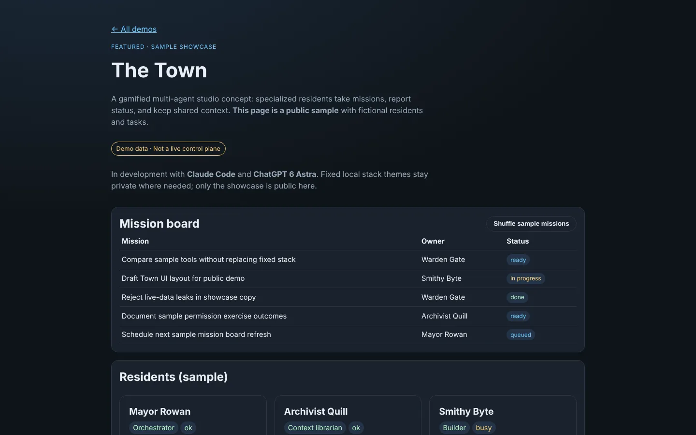
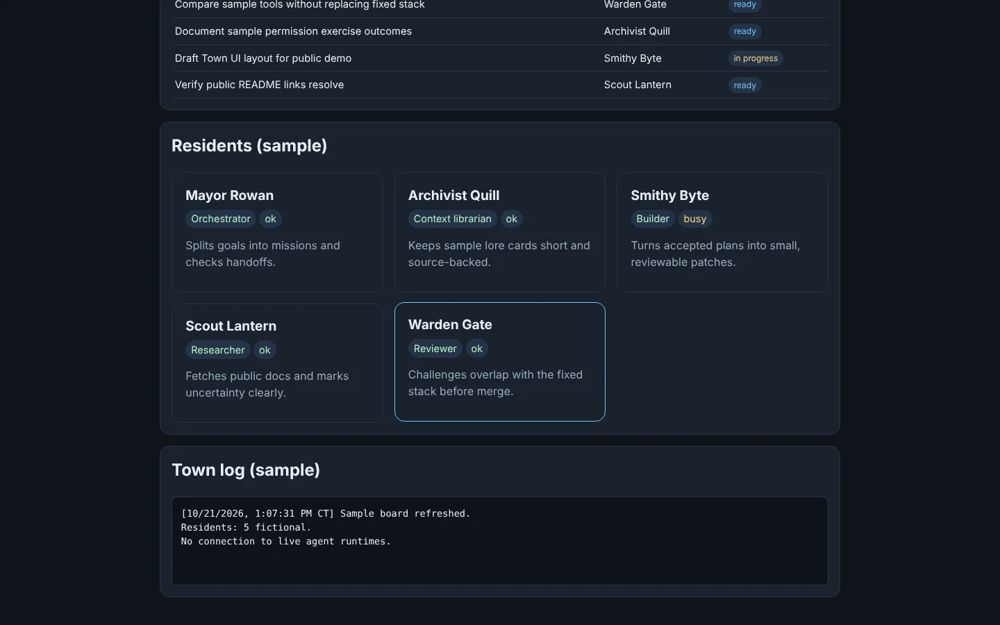
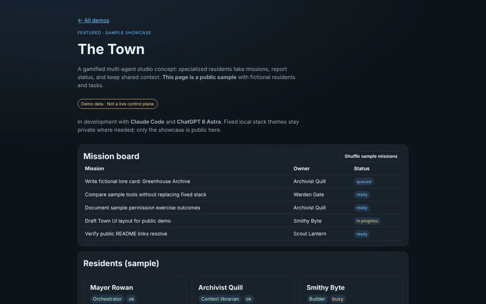
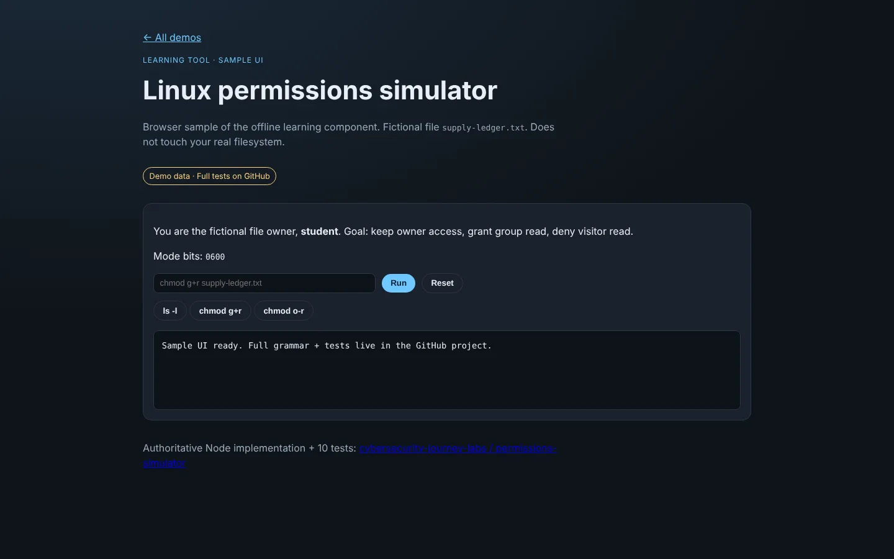
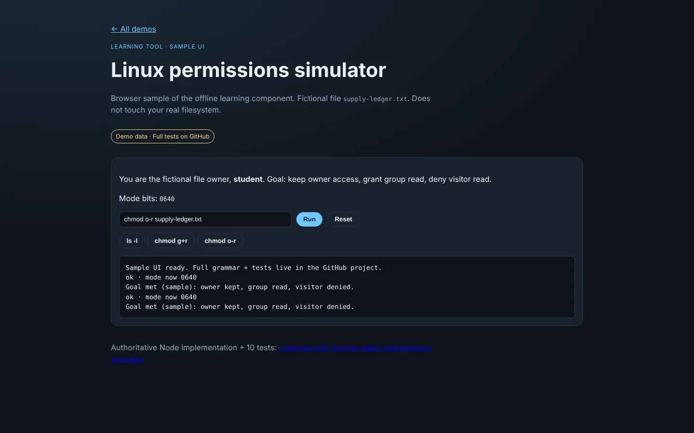
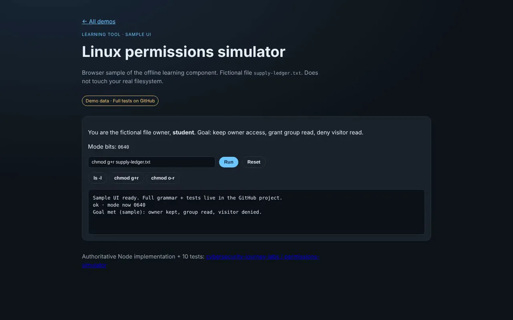

# Public demos — Casey Shingledecker (Beebopcat)

**Live, browser-viewable sample demonstrations of current and earlier projects.**

[**▶ Demo hub**](https://beebopcat.github.io/public-demos/) · [**The Town**](https://beebopcat.github.io/public-demos/town/) · [**Permissions Lab**](https://beebopcat.github.io/public-demos/permissions/) · [**Source**](https://github.com/Beebopcat/public-demos)

[](https://beebopcat.github.io/public-demos/town/)

## What it is

A GitHub Pages site of live sample demos. **Privacy rule:** this site uses fictional sample data only. It does not connect to live agents, private vaults, personal accounts, or real task queues.

| Demo | What you see |
| --- | --- |
| [Demo hub](https://beebopcat.github.io/public-demos/) | Index of all demos |
| [The Town (sample)](https://beebopcat.github.io/public-demos/town/) | Gamified multi-agent studio concept — sample residents and missions |
| [Permissions simulator (sample UI)](https://beebopcat.github.io/public-demos/permissions/) | Browser demo of the offline Linux permissions learning tool |
| [Natural Dialogue (sample)](https://beebopcat.github.io/public-demos/dialogue/) | Sample NPC dialogue + optional browser speech (not Windows Natural Voices) |

## The Town (sample)

[**▶ Live demo**](https://beebopcat.github.io/public-demos/town/) · [**On caseyshingledecker.com**](https://caseyshingledecker.com/demos/agent-town/index.html)

A public, fictional sample of a gamified multi-agent studio concept: specialized residents take missions, report status and share context. A banner on the page reads "Demo data. Not a live control plane."

### Screenshots

| | |
|:--:|:--:|
|  |  |
| <sub>The Town sample page with the mission board (fictional missions with owners and status chips) and the residents section.</sub> | <sub>Mission board after Shuffle sample missions, with rows reordered and statuses shown as ready, queued, in progress or done.</sub> |
|  |  |
| <sub>Residents grid with the Warden Gate card highlighted, below the mission board.</sub> | <sub>Residents grid and the Town log reading No connection to live agent runtimes.</sub> |

#### Video

[](docs/media/agent-town/clip.mp4)

**How to use**

1. Open the demo.
2. Use "Shuffle sample missions" to reshuffle the mission board.
3. Read the Residents (sample) grid and the Town log (sample).

**Features**

- Mission board table (Mission, Owner, Status)
- Residents (sample)
- Town log (sample)
- Shuffle sample missions button
- Banner: Demo data. Not a live control plane.

## Permissions Lab (sample UI)

[**▶ Live demo**](https://beebopcat.github.io/public-demos/permissions/) · [**On caseyshingledecker.com**](https://caseyshingledecker.com/demos/permissions/index.html)

A browser sample of an offline Linux permissions learning tool. Experiment with permissions in an interactive simulator that never touches the real filesystem. It is a simulation only: not Linux, not a shell and not a VM, and it executes no commands on the host.

### Screenshots

| | |
|:--:|:--:|
|  |  |
| <sub>Linux permissions simulator at its starting state, with mode bits 0600, a command field and the output log reading Sample UI ready.</sub> | <sub>After Run on chmod g+r, mode bits show 0640 and the output reports owner kept, group read and visitor denied.</sub> |
|  |  |
| <sub>After chmod o-r and Run, the output log lists repeated sample result lines with mode 0640.</sub> | <sub>After ls -l supply-ledger.txt is run, the output log shows the same sample result lines.</sub> |

#### Video

[](docs/media/permissions/clip.mp4)

**How to use**

1. Goal: keep owner access, grant group read, and deny visitor read on the fictional file `supply-ledger.txt`. You are the "visitor".
2. Use the chmod buttons or type commands (`ls -l`, `chmod g+r`, `chmod o-r`) and watch the mode bits change from 0600.
3. Press Run to check your work, and Reset to start over.

**Features**

- A fictional file, supply-ledger.txt, and a live mode-bits display
- Run and Reset controls
- Backed by a Node implementation with 10 automated tests in [cybersecurity-journey-labs](https://github.com/Beebopcat/cybersecurity-journey-labs) (strict parsing of pwd, ls, whoami, ls -l and chmod; two exercises, archive and greenhouse; malformed input is rejected without changing anything)

## Source projects

- [cybersecurity-journey-labs](https://github.com/Beebopcat/cybersecurity-journey-labs) — labs + Node permissions simulator (10 tests)
- [Natural-Dialogue](https://github.com/Beebopcat/Natural-Dialogue) — Windows TTS dialogue tooling
- [Profile](https://github.com/Beebopcat) — portfolio README
- Aetherhold / Agent Hub sources remain private until ready; public case studies live on the personal site

## Built with

- HTML, CSS and JavaScript (for example `town/town.js`)
- GitHub Pages (this repository)
- The permissions demo is backed by a Node.js implementation in cybersecurity-journey-labs

## Run it locally

```bash
git clone https://github.com/Beebopcat/public-demos.git
cd public-demos
python -m http.server 8000
```

Then open http://localhost:8000 (the Town is at `/town/`, the permissions demo at `/permissions/`).

## Credits & disclaimers

**Town credit:** The Town sample showcase describes a studio concept in active development with **Claude Code** and **ChatGPT 6 Astra**. The interactive page here is a public demonstration with fictional residents and missions — not a live production control plane.

**License:** Copyright (c) 2026 Casey Shingledecker. All rights reserved. Source-available for viewing and for personal, non-commercial running only; this is not open source. See [LICENSE](LICENSE). Linked product pages and game concepts keep their own terms.

Built by Casey Shingledecker with AI-assisted development.

## More projects

- Portfolio and live demos: https://caseyshingledecker.com/
- All repositories: https://github.com/Beebopcat
